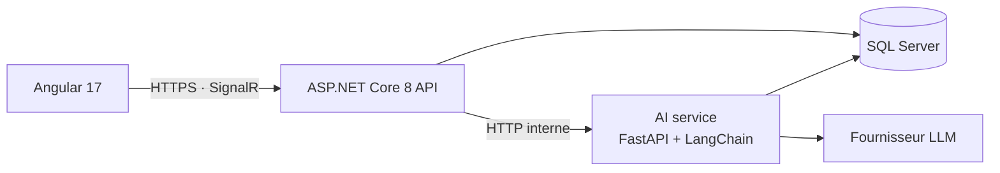

# Knowledge Keeper — la mémoire de l'entreprise

> Quand un employé part, son savoir part avec lui. Knowledge Keeper le capte avant son départ
> et le rend accessible à son successeur.

## Le problème
Les procédures non écrites, les contacts clés et les raisons des décisions passées disparaissent
à chaque démission, retraite ou mutation. Le remplaçant met des mois à les reconstruire.

## La solution
1. **Entretien de transmission IA** : un assistant interviewe l'employé sortant.
2. **Fiches de savoir** : l'entretien est transformé en fiches structurées (procédures, contacts, décisions, risques).
3. **Copilote du successeur** : il répond aux questions en citant l'extrait exact de l'entretien.
4. **Dashboard RH** : la carte des savoirs à risque par poste et par service.

## Architecture

Les règles d'accès sont appliquées par l'API .NET, jamais par le LLM.

## Structure du repo
| Dossier | Contenu |
| --- | --- |
| `frontend/` | Application Angular 17 |
| `backend/` | API ASP.NET Core 8 (Clean Architecture) |
| `ai-service/` | Service Python FastAPI + LangChain |
| `infra/` | Docker Compose, scripts |
| `docs/` | Documentation et ADR |

## Avancement
- [x] Étape 1 — Repo et conventions
- [x] Étape 2 — Docker Compose + SQL Server
- [ ] Étape 3 — Squelette backend
- [ ] Étape 4 — Modèle de domaine et base de données
- [ ] Étape 5 — Authentification JWT et rôles
- [ ] Étape 6 — Squelette AI service
- [ ] Étape 7 — Entretien de transmission IA
- [ ] Étape 8 — Extraction en fiches de savoir
- [ ] Étape 9 — Copilote RAG avec citations
- [ ] Étape 10 — Frontend Angular
- [ ] Étape 11 — Dashboard RH
- [ ] Étape 12 — Évaluation RAG, tests e2e, CI
- [ ] Étape 13 — Finitions démo

## Licence
MIT — voir [LICENSE](LICENSE)
